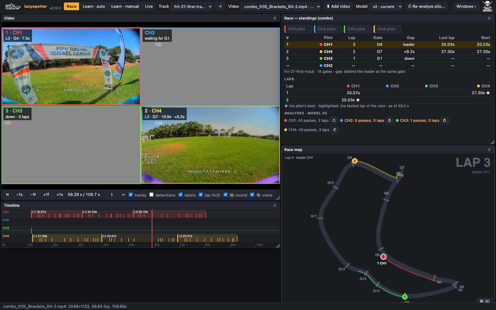
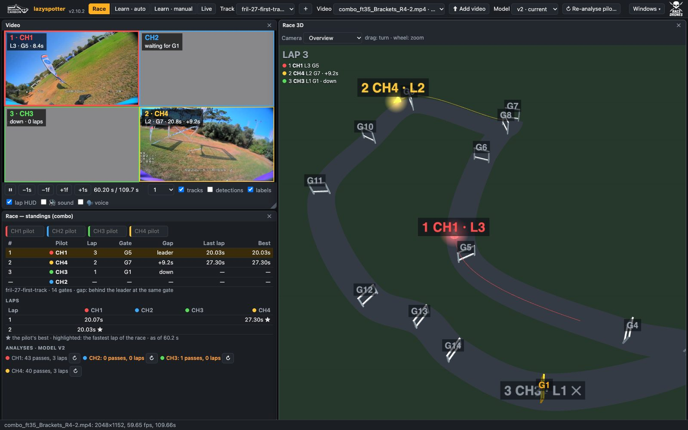
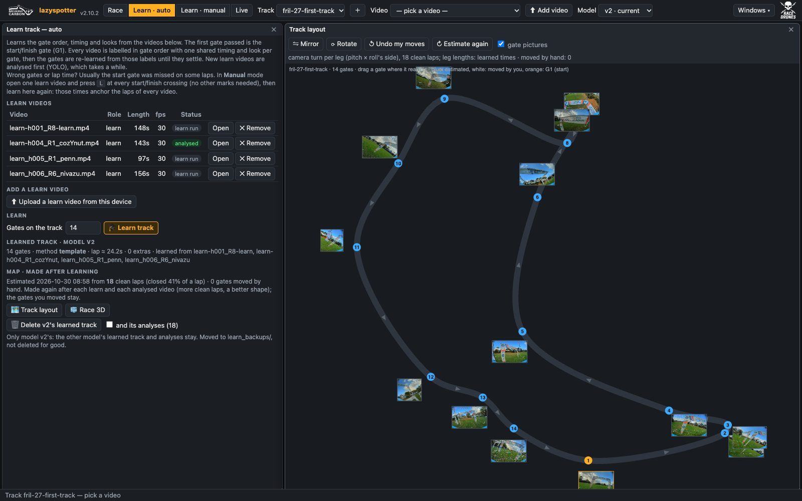

# FPV therealspotter 🏁

**Lap timing and race analysis for FPV drone racing, from the pilots' own video.**


-lightgrey)


therealspotter (the web app is called *lazyspotter*) watches FPV footage, finds every gate the drone flies
through, learns the track's gate order by itself, and gives you lap times, gate-to-gate splits and a race view.
It works on recorded videos after the race and live while the drones fly. Everything runs locally on your own
computer, with no cloud.

▶️ Video demo: https://www.youtube.com/watch?v=6A2gmpzc6iU

<p align="center">
  
  
  
</p>
<p align="center"><sub>A combo race: standings, laps and race map · the same race in 3D · a learned track and its map</sub></p>

---

## What it does

- **Analyses race videos.** Finds every gate pass, names each gate (G1…GN), times laps from start gate to start
  gate, and flags laps that need a human check (a skipped gate, a weak crossing).
- **Learns a track by itself.** Give it a few videos of the track and the number of gates. It learns the gate
  order, the time between gates and what each gate looks like, then estimates a rough map of the track.
- **Races pilots against each other.** A combo (quad) view of four pilots is split into one video per pilot,
  each is analysed, and playing the combo shows live standings, a race map, a 3D view and spoken call-outs
  ("Niv, lap 2, 20.0, best lap", "Daniel takes the lead").
- **Spots live.** From a capture card, a stream or a video played in real time: a beep on every pass, gate names,
  lap times spoken, and standings for up to four pilots at once.
- **Shares with pilots.** A locked-down *league* page lets pilots upload their own videos and see their analysis.

---

## Setup

### 1. Requirements

- **Python 3.11** (developed on it; 3.12–3.14 install too).
- **A Mac with Apple silicon** is what it's developed and tested on. Analysis uses the GPU (MPS). Linux and
  Windows with CUDA or CPU should work for analysis, but are less tested. Live mode's fastest path, Core ML, is
  Mac only.
- **ffmpeg** to split combo (quad) videos: `brew install ffmpeg`.
- About 2 GB of disk for the Python packages, plus space for your videos.

### 2. Install

```bash
git clone <this repository's URL> therealspotter
cd therealspotter
python3.11 -m venv venv

# PyTorch first, the right build for your machine:
./venv/bin/pip install torch torchvision                                                    # Mac (MPS) or CPU
# ./venv/bin/pip install torch torchvision --index-url https://download.pytorch.org/whl/cu121   # NVIDIA GPU

./venv/bin/pip install -r requirements.txt
```

### 3. Choose a data folder

Videos and everything made from them live **outside the repo**, in one data folder with one subfolder per track.
Create an empty folder anywhere and tell the app where it is:

```bash
mkdir -p ~/FPVdatasets
echo '{"data_root": "'$HOME'/FPVdatasets"}' > local_config.json
```

The app checks `$FPV_DATA_ROOT` first, then `data_root` in `local_config.json`. `local_config.json` is
git-ignored, so it stays on your machine.

### 4. Pick the model

The repo ships two models, each a gate detector plus a pass scorer, ready to use (`cyn_current-*.pt`,
`models/pass_scorer_v*.json`). Pick one in the top bar under **Model**:

| Model | What it is |
|---|---|
| **v2** (default) | the detector of 2026-07-15 with a one-threshold pass scorer: what the app has run since 2.0 |
| **v3** | cozYnut's detector (2026-10-21) and two-stage pass scorer: fewer false passes on his 52 reviewed videos |

Each model keeps its own analyses and learned tracks, so you can analyse a video with both and switch to compare.
From the command line: `./venv/bin/python model_profiles.py v3`. If you re-train v2's pass scorer on your own reviewed
videos (`pass_scorer.py <track> --save`), it's saved in `<data folder>/training/` and used instead of the shipped one.

The first analysis downloads the CLIP image model (about 350 MB, once), so it needs internet that one time.

### 5. Run

```bash
./venv/bin/python spotter_web.py
```

It opens http://127.0.0.1:8770 in your browser.

---

## First track, step by step

1. **Create the track.** Click **＋** in the top bar and give it a name (for example `field-2026-11`).
2. **Add learn videos.** Switch to **Learn · auto** and click **⬆ Add video**, adding 2–4 videos of pilots flying
   clean laps of the track, as *learn video*. The first gate a pilot passes in each video becomes G1 (start/finish).
3. **Learn.** Type the number of gates and click **🎓 Learn track**. New videos are analysed first, about 1.5–3 min
   for a 2-minute video. When it finishes you get the learned gates (pictures, order, timing) and a map of the track.
4. **Check the map.** Open **🗺 Track layout** to see the estimated top view. Drag gates to where they really are,
   and use mirror or rotate if needed. It's rough by design; it's only used for drawing.
5. **Analyse races.** Switch to **Race**, click **⬆ Add video** (as *race video*), then **▶ Run analysis**. You get
   laps, splits and flags. Play the video to see the passes on it.

If the start gate was missed on some laps and the lap times look wrong, use **Learn · manual**. Open a learn video,
press `L` each time the pilot crosses the start/finish, and learn again. Those marks anchor the laps.

---

## The web app

### Modes (top bar)

| Mode | What you do there |
|---|---|
| **Race** | Pick a track and a video, click **▶ Run analysis**, then review it: the video with tracked gates and lap HUD, a timeline, lap stats, gate splits, the passes. For a **combo view**, the pilots race each other: standings, race map, 🧊 3D view, call-outs. |
| **Learn · auto** | Add learn videos, enter the number of gates, click **🎓 Learn track**. See the learned gates, the map stage, and delete a model's learned track. |
| **Learn · manual** | Mark gates by hand while a video plays (`L` start gate / lap end, `G` each next gate), then **Learn track from marks**. |
| **Live** | Pick a feed, click **▶ Start**. Passes beep as they happen; on a learned track, gates are named and laps timed and spoken. |

Every mode shows **floating windows**: drag, resize or close them, and reopen them from **Windows ▾**. The layout
is remembered per mode. The address bar keeps the mode, track and video, so a link reopens the same view.

**Keys:** `Space` play/pause · `←/→` ±1 s · `Shift+←/→` ±10 s · `↑/↓` ±1 frame.

### Options in Race mode

- **Video window:** tracks / detections / labels overlays, lap HUD, 🔊 sound and 🗣 voice (lap times and place
  call-outs while it plays), and the pilot's name (guessed from the file name, e.g. `h001_R6_Nivazu` → Nivazu).
- **Spotter flags:** 🚩 a lap that skipped a gate; 🟠 a lap that needed a weak, recovered crossing. Both mean "a
  person should check this lap".
- **Combo (quad) views:** a 2048×1152 video with four pilots is detected on upload. **⊞ Split & analyse pilots**
  makes one video per pilot (`…_CH1` … `_CH4`) and analyses each. Pick the combo to race them. **↻ Re-analyse
  pilots** runs them again. Name the pilots in **Race — standings**.
- **Race map and 🧊 Race 3D:** the pilots on the track map as the video plays. The 3D view has an overview
  (drag to turn, scroll to zoom), chase the leader, chase a pilot, or on board.
- **Call-outs:** "Go!", lap times, "X takes the lead", "X is now second", "X is down", "X finishes".

### Live mode

| Setting | Choices |
|---|---|
| **Feed** | a video file of the track played in real time (×0.5 / ×1 / ×2) · a capture device (USB / HDMI card) · **receive a stream**: send RTMP or RTSP from a video system to the address the page shows |
| **Combo** | off · one channel of a quad view (CH1–CH4) · **all pilots — race**: all four at once with standings and race map |
| **Laps** | learned track: gate names, laps and spoken lap times · off: beeps only |
| **⚙ Performance** | presets *Live (fast)* and *Post-race quality* (PyTorch, input 640, every frame at 30 fps, a worker per pilot), or set each: detector (Core ML / PyTorch), input size (320–640), frames analysed a second (15 / 20 / 30 / every frame of the feed), a combo's pilots in one batch or a worker each, the picture's rate, CLIP on CPU or GPU. The spotter must see every frame it's set to; a smaller input is fine. |
| **⏺ save feed** | records the feed to `<data folder>/live_recordings/<track>/` to learn a new track from later |
| **Run on** | this Mac, or the media box (alpha, parked) |

The browser plays sound only after a click on the page, so press **▶ Start** or **test** first.

**Per-feed speed:** with Combo: all pilots, each pilot's tile shows its analysed fps and detector time, and Live — laps
lists per pilot the fps analysed, detector time, dropped frames and delay; orange means it can't keep up.

**Faster live on a Mac:** the detector is exported to Core ML once per input size (about a minute, into `exports/`).
At 320 it runs all four tiles of a combo in about 14 ms.

From the command line: `python online_spotter.py <combo.mp4> --combo-all --imgsz 640 --fps 30 --per-pilot` (add
`--fast` for every frame without real time, to compare with post-race).

---

## Launch options

```bash
./venv/bin/python spotter_web.py [--port 8770] [--lan] [--no-browser] [--league] [--tracks a,b]
```

| Option | What it does |
|---|---|
| `--port N` | listen on another port (default 8770) |
| `--lan` | also reachable from phones and other computers on your network: `http://<this computer's IP>:8770` |
| `--no-browser` | don't open a browser tab |
| `--league` | the page for pilots: Race mode only; upload and analyse their own videos; no learning, deleting or browsing |
| `--tracks a,b` | serve only these track folders (others are hidden) |

**Settings** (`local_config.json` next to the code, or environment variables):

| Setting | Where | Default |
|---|---|---|
| data folder | `$FPV_DATA_ROOT`, or `"data_root"` in `local_config.json` | must be set |
| model | `$FPV_MODEL`, or `"model"` in `local_config.json` (the top bar writes it) | `v2` |

### Sharing

- **Phones on the same Wi-Fi:** start with `--lan`. The page works on phones (windows stack vertically).
- **From anywhere:** a Cloudflare quick tunnel gives a temporary public https address, with no account needed:
  `cloudflared tunnel --url http://localhost:8770`. Anyone with that address can use the app while it runs.
- **League page for pilots:** run a second, locked-down server and tunnel only that one:

  ```bash
  ./venv/bin/python spotter_web.py --lan --no-browser --league --port 8780 --tracks my-track
  cloudflared tunnel --url http://localhost:8780
  ```

  Pilots see the analysed race videos and can upload their own (1 GB each, 2 per hour, 10 GB in total), which are
  analysed right away. Learning, deleting and re-analysing are refused.

---

## The data folder

```
<data folder>/
  <track>/
    learn_videos/        videos the track is learned from
    test_videos/         race videos (yours, pilots' uploads, a combo's split pilots)
    combo_videos/        quad views, once split
    removed_videos/      videos removed in the app (nothing is deleted for good)
    gate_memory.json     the learned gates the analysis uses   (v3: gate_memory.v3.json)
    gate_*.learned.json  what learning found: gates, order, timing
    gate_layout.json     the track map                         (v3: gate_layout.v3.json)
    runs/                v2's analyses: <video>.race_data.json, .motion.json, …   (v3: runs_v3/)
    learn_backups/       learned tracks deleted in the app
  live_recordings/       feeds saved in Live, per new track
  training/              pass scorer and YOLO training data
```

Every file made from a video starts with the video's name. Paths inside are relative, so the folder can be moved.

---

## Command-line tools

The web app runs all of these for you. They're also usable alone:

| Command | What it does |
|---|---|
| `python extract_race.py --video <file> --det-model cyn_current-20261021_best.pt` | analyse one race video (with the model picked) |
| `python learn_track.py <track> --gates 14 --install` | learn a track from its `learn_videos/` |
| `python learn_layout.py <track>` | estimate the track map again |
| `python relabel_run.py <video>` | re-label a saved analysis with the current learned track (seconds, no YOLO) |
| `python combo_split.py <combo.mp4>` | split a quad view into one video per pilot |
| `python online_spotter.py <video or device or rtsp://…>` | the live spotter without the web app |
| `python model_profiles.py [v2\|v3]` | show or pick the model |
| `python score.py` | score analyses against reviewed ground truth |
| `python race_day_app.py` | the older race-day desktop app (2×2 capture, dashboard) |

---

## Project layout

```
spotter_web.py, web/        the web app: FastAPI server (web/server.py) and the page (web/static/)
extract_race.py             race analysis: YOLO + tracker, pass scorer, gate names, laps
pass_scorer.py              decides passes after the fact     near_miss.py   weak crossings added back
gate_decoder.py             names gates by order, timing and look
learn_track.py              learns a track from videos         learn_layout.py   the track map
online_spotter.py           the live spotter                  online_decoder.py  naming gates live
combo_split.py              quad views                        feed_recorder.py   saving live feeds
model_profiles.py           the v2 / v3 models                dataset_paths.py   where the data lives
cyn_current-*.pt            YOLO gate detectors               models/            the v3 pass scorer
learn_ui.py, race_ui.py, debug_ui.py, race_day_app.py         older desktop tools (PyQt)
```

---

## More

- [docs/REFERENCE.md](docs/REFERENCE.md): how each part works and how it was measured: the pass scorer, gate
  decoding, track learning, live spotting and its benchmarks, the media box, the older desktop tools, training YOLO.
- [CHANGELOG.md](CHANGELOG.md): what changed in each version. The running version shows next to the logo in the
  app.
- [docs/PLAN.md](docs/PLAN.md), [docs/RACE_DAY_PLAN.md](docs/RACE_DAY_PLAN.md): plans and results.

**Known limits:** circle gates aren't supported yet. The detector was trained on a limited dataset. Live names gates
right about 85% of the time (offline about 93%), and about 1 lap in 6 is missed or estimated live.

License: free for non-commercial use; commercial use needs a separate license. See [LICENSE](LICENSE).
